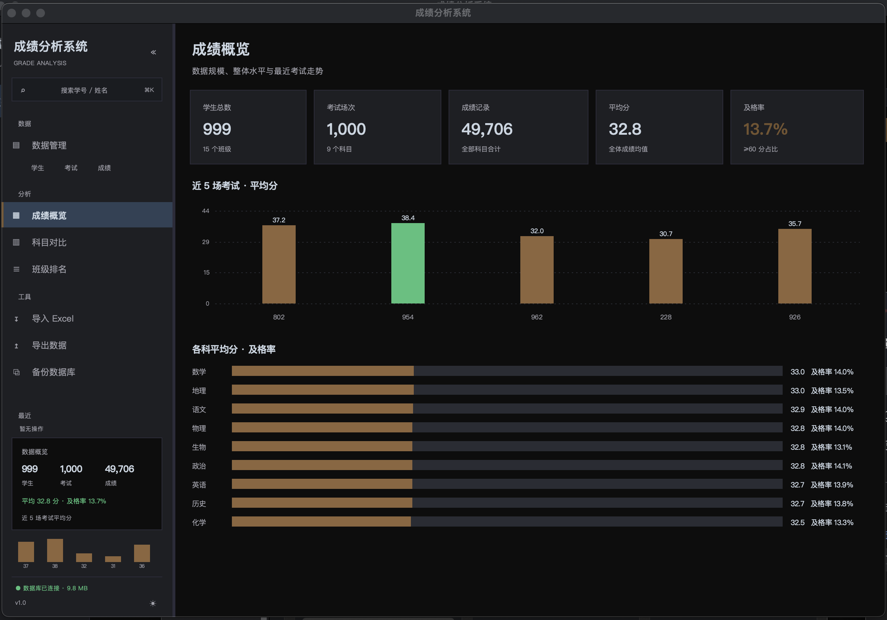
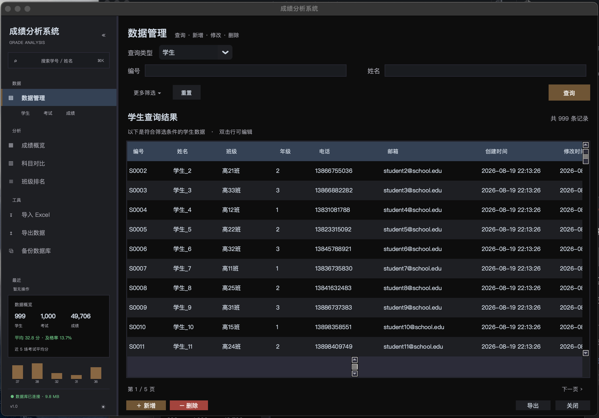
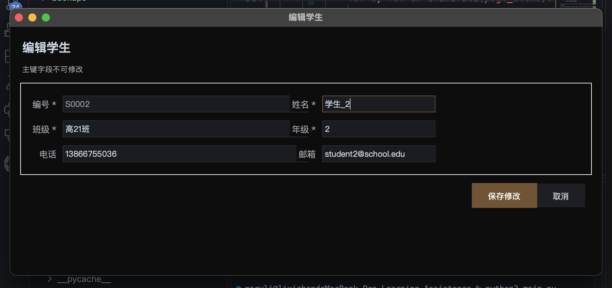
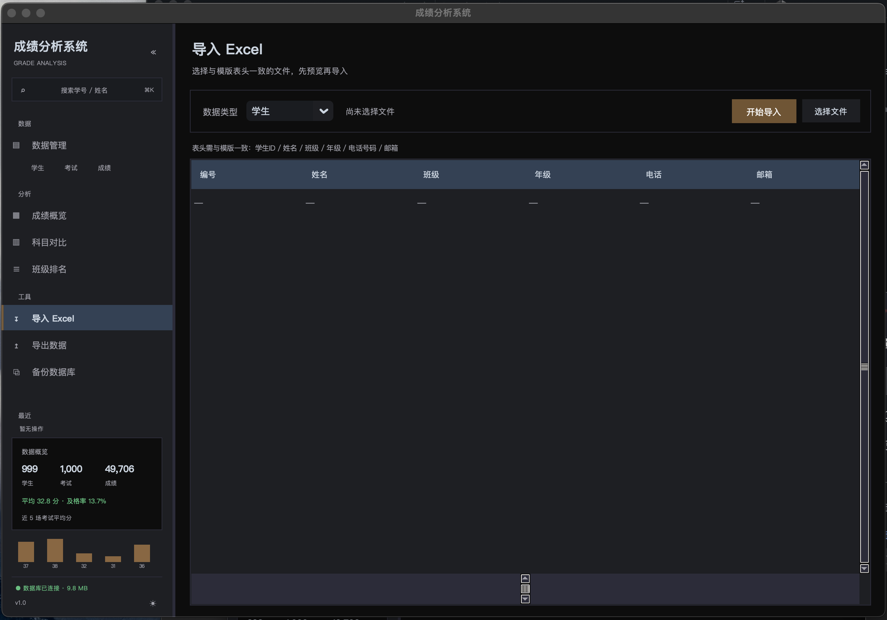
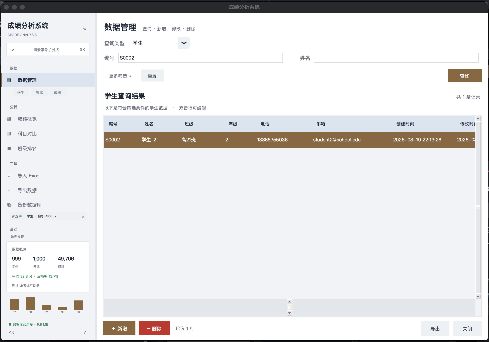
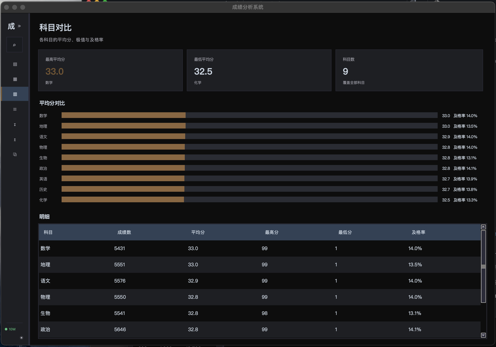

# 成绩分析系统

> 一个基于 **Python + Tkinter** 的桌面端成绩管理工具，面向 **学生 / 考试 / 成绩** 三类数据，
> 提供查询、增删改、批量导入导出与统计分析，界面支持暗色 / 亮色双主题。


---

## 目录

- [功能特性](#功能特性)
- [界面预览](#界面预览)
- [技术栈](#技术栈)
- [快速开始](#快速开始)
- [项目结构](#项目结构)
- [数据库设计](#数据库设计)
- [使用说明](#使用说明)
- [Excel 导入格式](#excel-导入格式)
- [快捷键](#快捷键)
- [常见问题](#常见问题)
- [开发说明](#开发说明)
- [路线图](#路线图)

---

## 功能特性

### 数据管理

- **三表统一管理**：学生、考试、成绩共用一套查询 / 编辑界面，切换类型自动换表单
- **查询**：常用条件默认展示，其余收进「更多筛选」；支持回车查询、条件重置
- **分页**：每页 200 条，成绩表 5 万行也能秒开（实测查询 + 渲染 81ms）
- **新增**：表单按类型自动生成，必填项标记、失焦即时校验、保存后可连续录入
- **修改**：双击任意行打开编辑弹窗，主键只读，改动即时校验
- **删除**：⌘ / Shift 多选，二次确认；删除学生 / 考试时会提示将级联删除多少条成绩
- **快捷操作**：删除键直接删、回车保存 / 查询

### 统计分析

- **成绩概览**：学生数 / 考试数 / 成绩数 / 平均分 / 及格率 五张 KPI 卡 + 近 5 场考试趋势 + 各科平均分
- **科目对比**：9 个科目的平均分、最高分、最低分、及格率对比与明细表
- **班级排名**：按平均分排序的班级榜单

### 工具

- **Excel 批量导入**：按模版表头解析 → 预览前 50 行 → 批量入库，自动跳过重复与无效行
- **全量导出**：任意一张表导出为带样式的 Excel
- **数据库备份**：一键复制到 `backups/my_database_时间戳.db`

### 界面体验

- **全局搜索 `⌘K`**：跨三张表搜索学号 / 姓名 / 考试编号 / 科目，回车直接定位到记录
- **侧边栏**：分组导航、类型快捷入口、数据概览卡、迷你趋势图、最近操作、筛选徽标、数据库状态
- **可折叠 / 可拖宽**：折叠成 68px 图标栏，或拖动边缘调整宽度（180–360px）
- **暗色 / 亮色主题**：底部一键切换，`⌘J` 亦可

---

## 界面预览

### 成绩概览



### 数据管理



### 编辑弹窗



### Excel 导入



### 亮色主题 & 折叠态

| 亮色主题 | 折叠图标栏 |
|---|---|
|  |  |

---

## 技术栈

| 分类 | 选型 |
|---|---|
| 语言 | Python 3.12 |
| GUI | Tkinter / ttk / [CustomTkinter](https://github.com/TomSchimansky/CustomTkinter) |
| 数据库 | SQLite 3（`sqlite3` 标准库） |
| Excel | openpyxl（读写）、pandas（数据读取工具类） |
| 模糊匹配 | rapidfuzz |
| 图标 / 图表 | 纯 Canvas 手绘，无第三方图表库 |

---

## 快速开始

### 1. 环境要求

- Python **3.10+**（开发与测试使用 3.12.7）
- macOS / Windows / Linux 均可运行（界面针对 macOS 做过适配）

### 2. 安装依赖

```bash
cd Learning_Assistance

# 建议使用虚拟环境
python3 -m venv .venv
source .venv/bin/activate        # Windows: .venv\Scripts\activate

pip install -r requirements.txt
```

### 3. 运行

```bash
python3 main.py
```

程序启动后会读取项目根目录下的 `my_database.db`，并默认打开「数据管理」页。

### 4. 关于数据库

项目自带一个约 5 万条成绩的示例数据库 `my_database.db`。

- 如果想从空库开始，可以删除该文件后执行：

```python
from DataBase.DataOperation import DatabaseManager
DatabaseManager("my_database.db").initialize_database()
```

> ⚠️ `initialize_database()` 会先 `DROP` 三张表再重建，请提前备份。

---

## 项目结构

```
Learning_Assistance/
├── main.py                     # 程序入口
├── my_database.db              # SQLite 数据库
├── my_database.db.bak          # 主键迁移前自动生成的备份
├── requirements.txt
├── README.md
│
├── UI/                         # 界面层
│   ├── MainWindow.py           # 主窗口：侧边栏、导航、全局搜索、主题
│   ├── OperateWindow.py        # 数据管理页：查询 / 增删改 / 分页
│   ├── AnalysisWindow.py       # 分析页：概览 / 科目对比 / 班级排名
│   ├── ToolWindow.py           # 工具页：导入 / 导出 / 备份
│   ├── widgets.py              # 控件工厂：按钮、输入框、卡片、确认弹窗、表格
│   ├── charts.py               # 图表：KPI 卡、柱状图、条形图、迷你趋势
│   └── theme.py                # 配色与字体（暗 / 亮两套）
│
├── Controller/
│   └── DataBaseController.py   # 业务层：查询过滤、增删改校验、统计、导入
│
├── DataBase/
│   └── DataOperation.py        # 数据访问层：建表、CRUD、统计 SQL、主键迁移
│
├── DataHandle/
│   └── ReadData.py             # pandas 读取 Excel 的工具类（示例/扩展用）
│
├── Utils/
│   └── ExcelOperater.py        # Excel 导出（样式、列宽、冻结表头）
│
├── TestData/                   # 三个导入模版示例文件
├── backups/                    # 数据库备份输出目录（运行时生成）
└── docs/images/                # README 截图
```

**分层约定**：`UI` 只负责收集与展示，`Controller` 做业务校验，`DataBase` 只写 SQL。

---

## 数据库设计

SQLite，三张表，成绩表通过外键关联学生与考试，并启用 `ON DELETE CASCADE`。

### students（学生）

| 字段 | 类型 | 说明 |
|---|---|---|
| `id` | TEXT **PK** | 编号，如 `S0001` |
| `name` | TEXT | 姓名 |
| `class` | TEXT | 班级 |
| `grade` | TEXT | 年级 |
| `telephonenum` | TEXT | 电话 |
| `email` | TEXT | 邮箱 |
| `createtime` | TEXT | 创建时间 `YYYY-MM-DD HH:MM:SS` |
| `changetime` | TEXT | 修改时间 |

### exams（考试）

| 字段 | 类型 | 说明 |
|---|---|---|
| `id` | TEXT **PK** | 考试编号，如 `E0001` |
| `name` | TEXT | 考试名称 |
| `date` | TEXT | 考试日期 `YYYY-MM-DD` |
| `createtime` / `changetime` | TEXT | 时间戳 |

### scores（成绩）

| 字段 | 类型 | 说明 |
|---|---|---|
| `student_id` | TEXT | 学号，外键 → `students.id` |
| `exam_id` | TEXT | 考试编号，外键 → `exams.id` |
| `subject` | TEXT | 科目 |
| `initialscore` | INTEGER | 初始分（卷面分） |
| `score` | INTEGER | 最终成绩（赋分后） |
| `rank` | INTEGER | 排名 |
| `headcount` | INTEGER | 总人数 |
| `createtime` / `changetime` | TEXT | 时间戳 |

> **主键为联合主键 `(student_id, exam_id, subject)`** —— 同一学生同一场考试可以录入多个科目。
> 早期版本主键是 `(student_id, exam_id)`，`DataOperation.upgrade_scores_schema()` 可把旧库自动升级（会先备份）。

---

## 使用说明

### 数据管理

1. 侧边栏点击「数据管理」，或用 `学生 / 考试 / 成绩` 快捷 chip 直接进入对应类型
2. 填写条件 → 点「查询」或按回车；点「更多筛选」展开其余条件
3. 结果表：
   - 底部翻页（每页 200 条）
   - 支持 ⌘ / Shift 多选，底部显示「已选 N 行」
   - **双击行**打开编辑弹窗
   - 选中后按 `Delete` / `Backspace` 或点「− 删除」
4. 「＋ 新增」打开录入弹窗，保存后输入框自动清空，可连续录入；点「保存并关闭」回到列表并跳到最后一页

**校验规则**

| 字段 | 规则 |
|---|---|
| 必填项 | 不能为空（带 `*` 标记） |
| 初始成绩 / 成绩 / 排名 / 总人数 | 必须是整数 |
| 电话 | 11 位数字（可留空） |
| 邮箱 | 需包含 `@` 与域名后缀（可留空） |
| 考试日期 | `YYYY-MM-DD` |
| 编号 / 学号 / 考试编号 | 主键重复会拦截；成绩还要求学号与考试编号已存在 |

### 分析

- **成绩概览**：整体规模与水平，近 5 场考试平均分趋势，各科平均分对比
- **科目对比**：各科极值、及格率与明细表
- **班级排名**：只统计有成绩的班级，按平均分降序

### 工具

- **导入 Excel**：选择数据类型 → 选择文件 → 预览 → 开始导入
- **导出数据**：选择类型 → 选择保存位置
- **备份数据库**：复制到 `backups/`，弹窗显示备份路径与大小

---

## Excel 导入格式

导入时**表头必须与下表完全一致**（顺序敏感），从第 2 行开始读取数据。

### 学生

| 学生ID | 姓名 | 班级 | 年级 | 电话号码 | 邮箱 |
|---|---|---|---|---|---|
| S0001 | 学生_1 | 高11班 | 1 | 13875682867 | student1@school.edu |

### 考试

| 考试ID | 考试名称 | 考试日期 |
|---|---|---|
| E0001 | 统考 | 2023-10-28 |

### 成绩

| 学生ID | 考试ID | 科目 | 成绩 | 排名 | 总人数 | 赋分 |
|---|---|---|---|---|---|---|
| S0001 | E0982 | 语文 | 80 | 22 | 57 | 80 |

> **字段映射**：`成绩` → `initialscore`（初始分），`赋分` → `score`（最终成绩）。
> 导入成绩前，对应的学生与考试必须已存在，否则该行会被计为「无效跳过」。

示例文件见 [`TestData/`](TestData/)。

---

## 快捷键

| 快捷键 | 作用 |
|---|---|
| `⌘K` / `Ctrl+K` | 打开全局搜索 |
| `⌘B` / `Ctrl+B` | 折叠 / 展开侧边栏 |
| `⌘J` / `Ctrl+J` | 切换暗 / 亮主题 |
| `Enter` | 查询（表单内）/ 保存（弹窗内） |
| `Delete` / `Backspace` | 删除选中的行（表格聚焦时） |
| `Esc` | 关闭弹窗 |

---

## 常见问题

**Q：启动报错 `no such table: students`？**
数据库文件缺失或为空。参考[关于数据库](#4-关于数据库)初始化，或放回项目自带的 `my_database.db`。

**Q：中文显示成方块？**
界面统一使用 `PingFang SC`（macOS 自带）。Windows / Linux 可在 `UI/theme.py` 中把 `FONT_FAMILY` 换成 `Microsoft YaHei` / `Noto Sans CJK SC`。

**Q：为什么 `tk.Button` 改了背景色没反应？**
macOS 上系统会忽略 `tk.Button` 的 `bg`。本项目所有按钮都用 `tk.Label + <Button-1>` 实现（见 `UI/widgets.py`），以保证配色生效。

**Q：导入时提示表头不匹配？**
检查列名与顺序是否与[导入格式](#excel-导入格式)一致（表头不能多列、少列或换顺序）。

**Q：导入很慢吗？**
实测 148,938 行成绩导入耗时约 **0.3s**（单事务批量插入）。导入期间界面会短暂无响应，属预期。

**Q：删除能撤销吗？**
暂不支持。删除前会二次确认并提示级联影响；重要数据请先用「备份数据库」。

**Q：主题切换后筛选条件没了？**
主题切换会重建整个界面以保证所有控件吃到新配色，当前页会保留，但筛选条件会重置。

---

## 开发说明

### 如何新增一个字段

以学生表新增「性别」为例：

1. **数据库**：`ALTER TABLE students ADD COLUMN gender TEXT DEFAULT ''`
2. **导入配置**：`SEARCH_CONFIG["学生"]` 中补充
   - `columns` / `headers`（结果表列）
   - `query_fields`（查询条件）
   - `add_fields`（新增 / 编辑表单）
3. **查询**：`DataOperation.query_students` 增加参数与 `WHERE` 分支
4. **写入**：`insert_data` / `update_row` 的 INSERT / UPDATE 语句与参数顺序

### 扩展新页面

1. 在 `UI/` 下新建页面类，构造函数接收 `(root, content_frame)`
2. 在 `MainWindow._build_ui` 中实例化
3. 在 `NAV_SECTIONS` 里加一项，并在 `_open_page` 中分发

### 主题

所有颜色集中在 `UI/theme.py`（`DARK` / `LIGHT` 两套），控件通过 `COLORS["key"]` 取色；
主题切换调用 `theme.set_theme()` 后重建界面。

### 已知限制

- 表头暂不支持点击排序，列宽不记忆
- 删除为硬删除，无撤销
- 导入为同步执行（大数据量时界面短暂卡住）
- 单机单用户，无登录与权限控制

---

## 路线图

- [ ] 表头点击排序、列宽记忆
- [ ] 删除后 5 秒内撤销（软删除）
- [ ] 成绩单 / 班级报告导出（Excel 多 Sheet 或 PDF）
- [ ] 图表点击联动筛选
- [ ] 数据校验规则可配置化

---

## 版本

**v1.0** — 学生 / 考试 / 成绩三表管理、统计分析、批量导入导出、暗亮主题。

数据库迁移记录：

- `scores` 主键由 `(student_id, exam_id)` 升级为 `(student_id, exam_id, subject)`，迁移前自动备份为 `my_database.db.bak`
